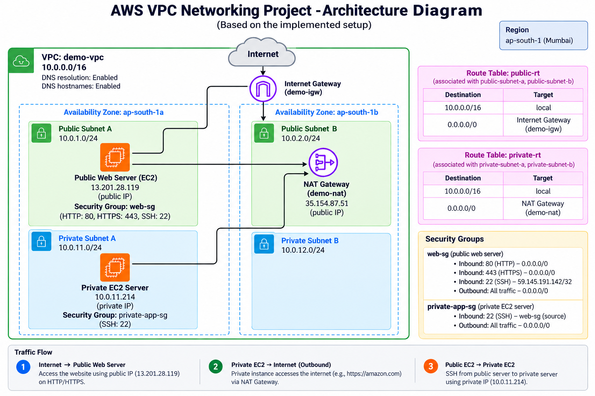

\# AWS VPC Networking Project

\### Designing and Implementing Public and Private Network Infrastructure on AWS

A hands-on cloud networking project demonstrating VPC design, subnet segmentation, internet routing, NAT Gateway connectivity, EC2 deployment, and security group configuration.

 

!\[AWS](https://img.shields.io/badge/AWS-Cloud-orange?style=for-the-badge\&logo=amazonaws\&logoColor=white)

!\[Amazon VPC](https://img.shields.io/badge/Networking-VPC-8C4FFF?style=for-the-badge\&logo=amazonaws\&logoColor=white)

!\[Amazon EC2](https://img.shields.io/badge/Compute-EC2-FF9900?style=for-the-badge\&logo=amazonec2\&logoColor=white)

!\[Amazon Linux](https://img.shields.io/badge/OS-Amazon\_Linux-232F3E?style=for-the-badge\&logo=linux\&logoColor=white)

\*\*Region:\*\* Asia Pacific (Mumbai) — `ap-south-1`

\---

\## Project Overview

This project implements a custom Amazon Virtual Private Cloud (VPC) with public and private subnets distributed across two Availability Zones.

The infrastructure demonstrates how to configure network routing, provide public access to a web server, enable outbound internet connectivity for private resources, and restrict instance access using security groups.

\### Project Objectives

\- Create a custom VPC with a structured IPv4 CIDR range.

\- Configure public and private subnets across two Availability Zones.

\- Attach an Internet Gateway for public network connectivity.

\- Configure a NAT Gateway for private-subnet outbound connectivity.

\- Implement public and private route tables.

\- Deploy public and private EC2 instances.

\- Configure security groups and IAM permissions.

\- Access the private instance using Systems Manager Session Manager.

\- Validate public website access and private-instance HTTPS connectivity.

\---

\## Architecture

\*AWS VPC architecture implemented in the Mumbai region.\*

\### Network Traffic Flow

| Traffic | Route |

|---|---|

| Public website access | Internet → Internet Gateway → Public EC2 |

| Private outbound internet access | Private EC2 → NAT Gateway → Internet Gateway → Internet |

| Internal VPC communication | VPC local route, subject to security rules |

The private EC2 instance does not require a public IPv4 address to initiate outbound internet connections through the NAT Gateway.

\---

\## AWS Services and Tools Used

| Service | Purpose |

|---|---|

| Amazon VPC | Custom isolated virtual network |

| Amazon EC2 | Public web server and private compute instance |

| Amazon VPC Subnets | Public/private network segmentation |

| Internet Gateway | Public internet routing |

| NAT Gateway | Outbound internet connectivity for private resources |

