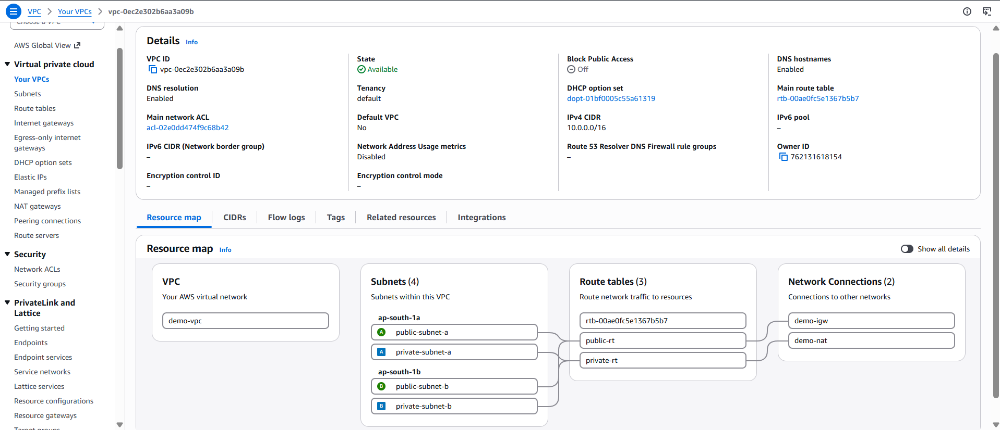
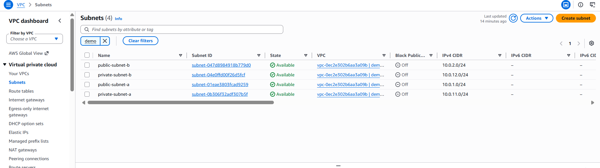
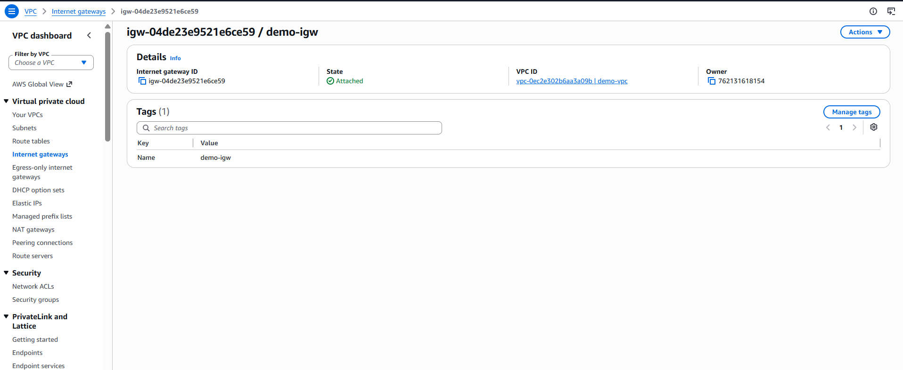
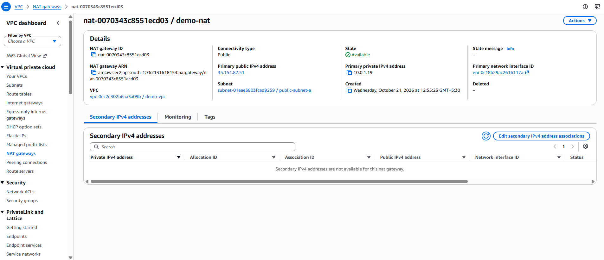
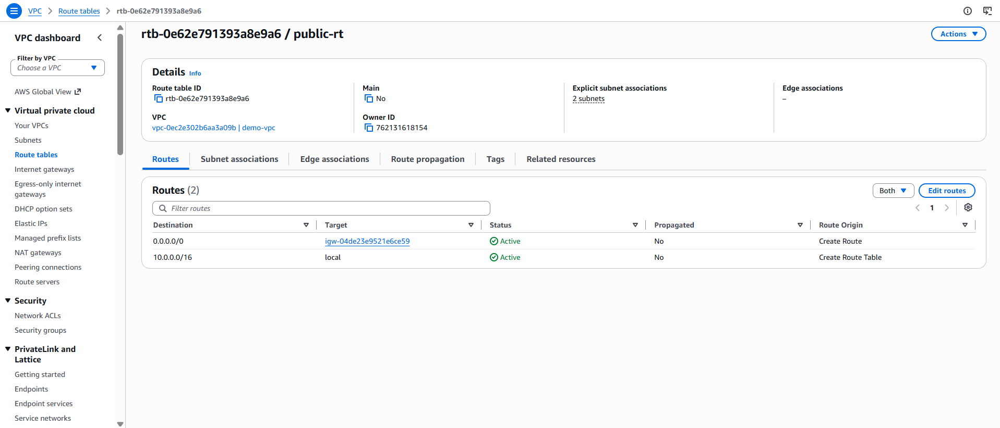
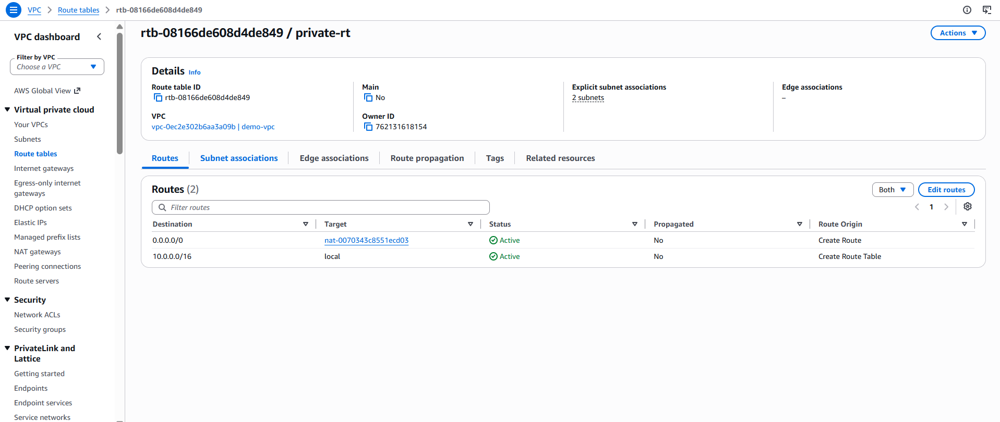
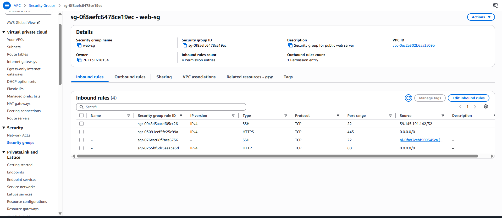
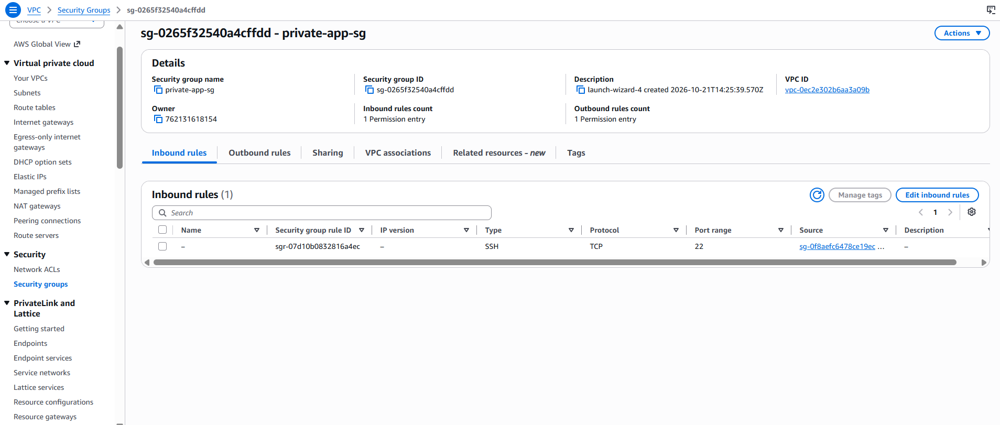

<div align="center">


\# AWS VPC NETWORKING


\### Secure Network Architecture on Amazon Web Services


\*\*Design · Deploy · Route · Secure · Validate\*\*


A hands-on AWS project implementing a custom Virtual Private Cloud with public and private subnets, controlled internet access, EC2 instances, and private-network connectivity.


<br/>


!\[AWS](https://img.shields.io/badge/AWS-232F3E?style=for-the-badge\&logo=amazonwebservices\&logoColor=white)

!\[VPC](https://img.shields.io/badge/Amazon\_VPC-8C4FFF?style=for-the-badge\&logo=amazonaws\&logoColor=white)

!\[EC2](https://img.shields.io/badge/Amazon\_EC2-FF9900?style=for-the-badge\&logo=amazonec2\&logoColor=white)

!\[Linux](https://img.shields.io/badge/Amazon\_Linux-232F3E?style=for-the-badge\&logo=linux\&logoColor=white)


\*\*Region:\*\* AWS Asia Pacific (Mumbai) · `ap-south-1`


</div>


\---


\## 01 / Architecture


The infrastructure separates public-facing resources from private workloads, using route tables, an Internet Gateway, and a NAT Gateway to control connectivity.


<div align="center">

&#x20; 

</div>


\### Traffic Flow


| Traffic | Network Path |

|---|---|

| Public website request | Internet → Internet Gateway → Public EC2 |

| Private instance outbound request | Private EC2 → NAT Gateway → Internet Gateway → Internet |

| Internal VPC communication | Resources communicate through VPC local routing, subject to security rules |


> \*\*Design principle:\*\* Private instances do not require public IPv4 addresses to initiate outbound internet connections through a NAT Gateway.


\---


\## 02 / Infrastructure at a Glance


<table>

<tr>

<td width="50%" valign="top">


\### Network


| Property | Value |

|---|---|

| VPC | `demo-vpc` |

| CIDR | `10.0.0.0/16` |

| Availability Zones | 2 |

| Total subnets | 4 |

| DNS resolution | Enabled |

| DNS hostnames | Enabled |


</td>

<td width="50%" valign="top">


\### Connectivity


| Component | Resource |

|---|---|

| Internet Gateway | `demo-igw` |

| NAT Gateway | `demo-nat` |

| Public route table | `public-rt` |

| Private route table | `private-rt` |

| Public compute | Amazon EC2 |

| Private access | Systems Manager |


</td>

</tr>

</table>


\### Subnet Design


| Subnet | IPv4 CIDR | Availability Zone | Role |

|---|---|---|---|

| `public-subnet-a` | `10.0.1.0/24` | `ap-south-1a` | Public web server and NAT Gateway |

| `public-subnet-b` | `10.0.2.0/24` | `ap-south-1b` | Additional public subnet |

| `private-subnet-a` | `10.0.11.0/24` | `ap-south-1a` | Private EC2 workload |

| `private-subnet-b` | `10.0.12.0/24` | `ap-south-1b` | Additional private subnet |


\### Routing Design


| Route Table | Destination | Target |

|---|---|---|

| Public | `10.0.0.0/16` | Local |

| Public | `0.0.0.0/0` | Internet Gateway |

| Private | `10.0.0.0/16` | Local |

| Private | `0.0.0.0/0` | NAT Gateway |


Both public subnets use `public-rt`; both private subnets use `private-rt`.


\---


\## 03 / AWS Services


| Service | Implementation |

|---|---|

| Amazon VPC | Custom isolated network |

| Amazon EC2 | Public web server and private instance |

| Internet Gateway | Public internet routing |

| NAT Gateway | Outbound internet connectivity for private subnets |

| Elastic IP | Public IP associated with the NAT Gateway |

| Route Tables | Public and private traffic routing |

| Security Groups | Instance-level traffic filtering |

| AWS IAM | Permissions for Systems Manager access |

| AWS Systems Manager | Private instance access through Session Manager |

| Apache HTTP Server | Public website hosting |


\---


\## 04 / Implementation


\### 01 — Network Foundation

Created a custom VPC and four subnets distributed across two Availability Zones.


\### 02 — Internet Routing

Attached an Internet Gateway and configured public routes for internet-bound traffic.


\### 03 — Private Connectivity

Provisioned a NAT Gateway in a public subnet and routed private-subnet internet traffic through it.


\### 04 — Compute Deployment

Deployed two Amazon Linux 2023 instances: a public EC2 web server and a private EC2 instance without a public IPv4 address.


\### 05 — Access Control

Configured security groups and an IAM role for Systems Manager Session Manager access.


\### 06 — Validation

Tested the public website, opened a Session Manager session, and verified outbound HTTPS connectivity from the private instance.


\---


\## 05 / Security Configuration


| Security Group | Inbound Configuration | Purpose |

|---|---|---|

| `web-sg` | HTTP `80`, HTTPS `443`, restricted SSH `22` | Web access and controlled administration |

| `private-app-sg` | SSH `22` from `web-sg` | Restrict SSH access by security group |

| `db-sg` | TCP `3306` from `web-sg` | Demonstrate a database-oriented access rule |


\*\*Security notes\*\*

\- The private EC2 instance has no public IPv4 address.

\- Systems Manager Session Manager provides access without requiring a public SSH endpoint.

\- Security groups restrict inbound traffic according to configured rules.

\- `db-sg` was created, but no database server was deployed.


\---


\## 06 / Validation Results


| Validation | Result |

|---|---|

| VPC and subnet configuration | Verified |

| Internet Gateway attachment | Successful |

| Public route configuration | Verified |

| NAT Gateway provisioning | Successful |

| Private route configuration | Verified |

| Public Apache website | Tested |

| Session Manager connectivity | Successful |

| Private instance outbound HTTPS | Successful |


\### Private Network Connectivity


Executed from the private EC2 instance:


```bash

curl -I --connect-timeout 10 https://amazon.com

```


\*\*Observed:\*\* HTTP `301 Moved Permanently`, redirecting to `https://www.amazon.com/`.


This response demonstrated successful domain resolution and outbound HTTPS connectivity from the private instance.


\---


\## 07 / Project Evidence


The screenshots below document the actual AWS Console configuration and connectivity tests.


\### Network Infrastructure


<table>

<tr>

<th width="50%">VPC Configuration</th>

<th width="50%">Subnet Configuration</th>

</tr>

<tr>

<td></td>

<td></td>

</tr>

<tr>

<th>Internet Gateway</th>

<th>NAT Gateway</th>

</tr>

<tr>

<td></td>

<td></td>

</tr>

</table>


\### Routing \& Security


<table>

<tr>

<th width="50%">Public Route Table</th>

<th width="50%">Private Route Table</th>

</tr>

<tr>

<td></td>

<td></td>

</tr>

<tr>

<th>Web Security Group</th>

<th>Private Security Group</th>

</tr>

<tr>

<td></td>

<td></td>

</tr>

</table>


\### Deployment

